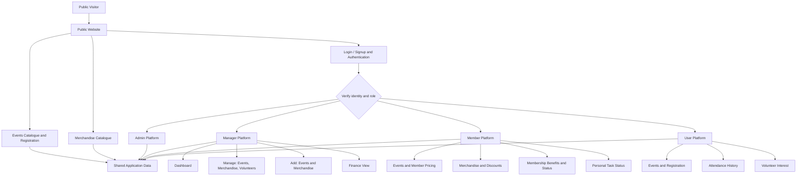

# Architecture — Skyline Student Association Platform

## 1. Purpose
This document describes the proposed high-level structure of the Skyline Student Association Platform. It records the architecture implied by the current PRD without assuming an unconfirmed technology stack or implementation.

## 2. System Overview
The platform has a public website and four role-based areas:

- Public website: events, merchandise, and login/signup entry points.
- Admin platform: administrative responsibilities to be defined.
- Manager platform: dashboard, event management, merchandise management, volunteer management, and finance viewing.
- Member platform: events, merchandise, membership benefits/pricing/status, and personal task status.
- User platform: event browsing/registration, attendance history, and volunteer interest.

Authentication must verify the user's actual permissions. Selecting a role in the login dropdown is not proof of authorization.

## 3. High-Level Component Diagram



## 4. Logical Components

### 4.1 Public Website
- Displays available events as cards.
- Allows event registration without mandatory login.
- Displays merchandise as product cards.
- Provides entry points for login/signup.

### 4.2 Authentication and Authorization
- Provides login/signup routes for Admin, Manager, Member, and User.
- Authenticates the person.
- Checks the assigned role and permissions before granting access.
- Routes the authenticated person to the appropriate platform.
- Must not trust a role selected in the UI without server-side authorization.

The exact authentication provider, session strategy, and signup approval process are not yet specified.

### 4.3 Events
- Supplies event information to the public website and role-based views.
- Supports public registration using basic participant details.
- Allows managers to view and manage existing events and registrations.
- Supports member pricing where applicable.

The precise event fields, registration limits, ticketing, and check-in behavior are not defined in the current scope.

### 4.4 Merchandise
- Supplies merchandise listings to the public catalogue and member view.
- Allows managers to add and manage products.
- Displays applicable member discounts.

The order workflow, payment processing, stock tracking, and fulfillment details are not defined in the current scope.

### 4.5 Volunteer Management
- Allows managers to view volunteers and task assignments.
- Allows users to express interest in volunteering.
- Allows members to view their own task status.

The process for converting volunteer interest into an assignment and the exact task lifecycle remain to be defined.

### 4.6 Membership
- Provides members with membership pricing, status, benefits, and applicable discounts.
- Supports the member-specific views described in the PRD.

Membership creation, payment, renewal, expiry rules, and verification details are not yet specified.

### 4.7 Finance
- Provides managers with a view of association financial information.
- Detailed reports, transaction categories, expense approvals, and accounting rules remain to be defined.

### 4.8 Admin
- Provides an administrative area with the agreed minimal header.
- Admin responsibilities and permissions remain to be defined; no additional capabilities are assumed here.

## 5. Main Data Domains

The following are conceptual data domains, not a finalized database schema:

| Domain | Purpose |
|---|---|
| User and Role | Identity, role assignment, and access permissions |
| Event | Event details and availability |
| Event Registration | Participant details and event registration records |
| Merchandise Product | Product information and prices |
| Membership | Membership status, pricing, benefits, and discounts |
| Volunteer | Volunteer interest and volunteer records |
| Task Assignment | Event tasks and assigned people |
| Attendance | Records of events attended |
| Finance | Association financial information |

The relationships, field definitions, constraints, and database technology must be decided during implementation planning.

## 6. Key Data Flows

### 6.1 Public Event Registration
1. Visitor opens the event catalogue.
2. Visitor selects an event and submits the registration form.
3. The application validates the supplied details.
4. A registration record is saved.
5. The application displays a confirmation.

### 6.2 Role-Based Access
1. Person selects a role and opens the relevant login/signup route.
2. The application authenticates the person.
3. The application checks their actual role and permissions.
4. The person is redirected only to an authorized platform.

### 6.3 Event or Merchandise Creation
1. Manager opens the Add section.
2. Manager submits an event or merchandise form.
3. The application validates and saves the record.
4. The record appears in the relevant Manage section.
5. Public display follows the item's availability/publication state, once those rules are defined.

### 6.4 Volunteer Assignment
1. User expresses volunteer interest.
2. Manager views volunteer records.
3. Manager assigns a task through the volunteer management workflow, once finalized.
4. The assigned member can view their own task status.

## 7. Access Control Principles

- Public event and merchandise browsing does not require login.
- Public event registration does not require an account, as specified in the PRD.
- Manager functions are restricted to authorized managers.
- Member-specific pricing, benefits, and task status are available only to the appropriate member.
- Attendance history and volunteer-interest records are associated with the relevant user.
- Users must not be able to access another person's private records by changing a URL or request.
- Admin permissions must remain limited to explicitly defined responsibilities until the Admin scope is finalized.

## 8. Proposed Application Structure

The following is a logical structure only. Folder names and framework conventions should be adapted to the repository's actual stack.

```text
project-root/
├── frontend/
│   ├── public-site/
│   ├── admin/
│   ├── manager/
│   ├── member/
│   ├── user/
│   └── shared/
│       ├── components/
│       ├── layouts/
│       └── utilities/
├── backend/
│   ├── authentication/
│   ├── users/
│   ├── events/
│   ├── registrations/
│   ├── merchandise/
│   ├── memberships/
│   ├── volunteers/
│   ├── tasks/
│   ├── attendance/
│   └── finance/
├── docs/
│   ├── PRD.md
│   ├── ARCHITECTURE.md
│   └── MEMORY.md
└── README.md
```

This is an illustrative organization, not a claim about the repository's current folders. Do not restructure the project solely to match this example without checking the existing codebase.

## 9. Technology Decisions

The current PRD does not establish the final technology stack. Therefore, this document does not assume a frontend framework, backend framework, database, ORM, hosting provider, or authentication library.

Before implementation, document the selected technologies and versions here, based on the actual project configuration.

## 10. Open Decisions

The following are intentionally unresolved:
- Admin responsibilities and permissions.
- Exact event, registration, merchandise, membership, volunteer, task, attendance, and finance fields.
- Signup eligibility and role assignment rules.
- Whether merchandise ordering includes payment and stock management.
- Whether events have capacity limits or ticket/check-in workflows.
- Volunteer interest approval and task assignment lifecycle.
- Detailed finance reporting and transaction workflows.
- Technology stack and deployment architecture.

## 11. Architecture Maintenance Rules

- Update this document when an architectural decision is made or the architecture changes.
- Record only decisions that have been agreed or verified in the codebase.
- Mark assumptions and unresolved items clearly.
- Keep `PRD.md` as the source for product requirements and `MEMORY.md` as the factual log of completed work.
- Do not treat this proposed architecture as proof that a feature has already been implemented.
